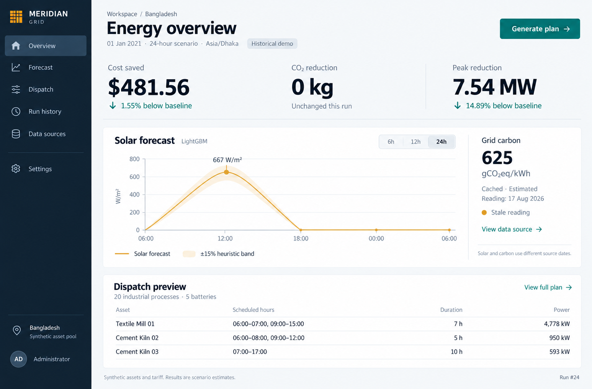
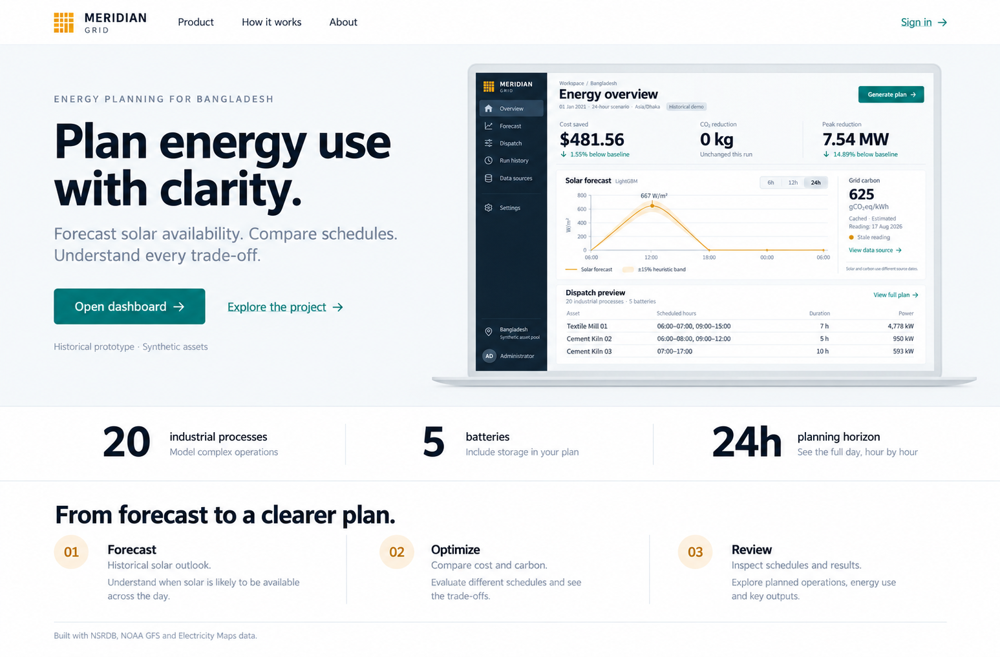
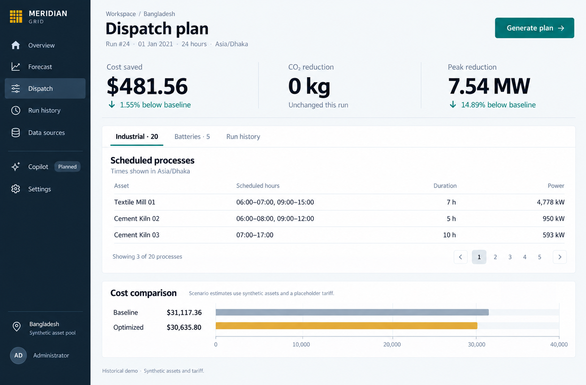
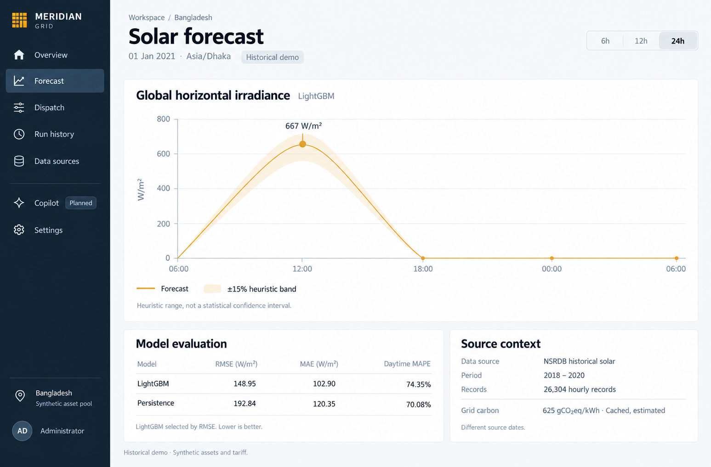
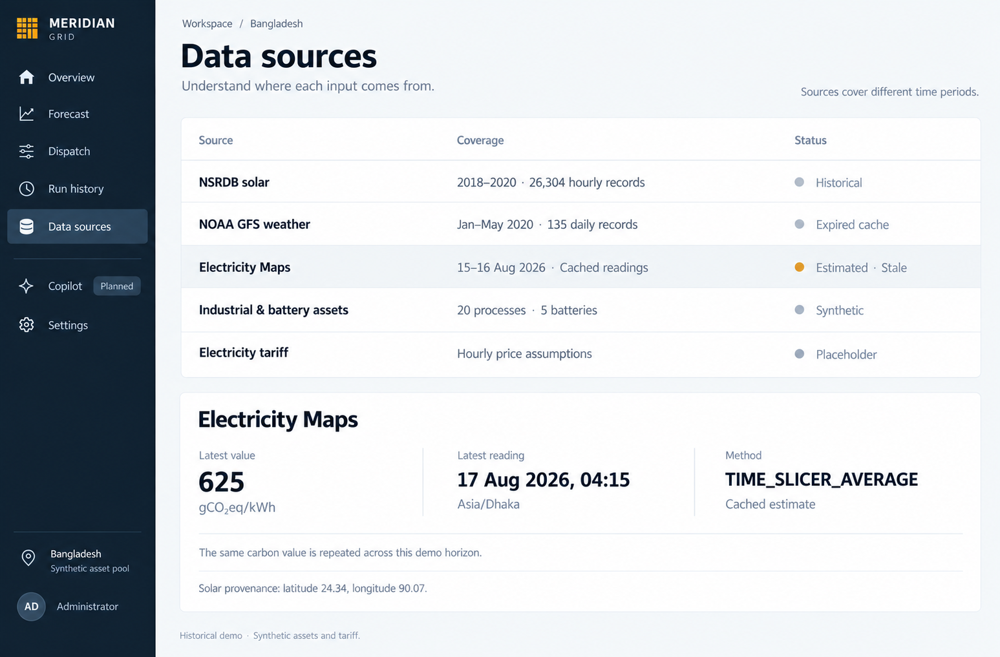
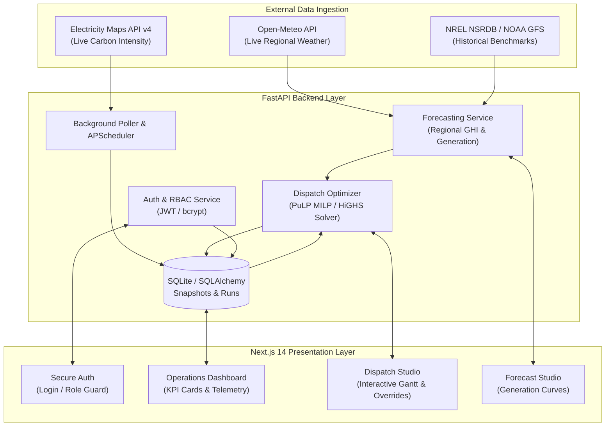

<div align="center">

# ⚡ Meridian Grid
### Universal Flexible-Load Orchestration & Carbon-Aware Dispatch Engine

[](https://www.python.org/)
[](https://fastapi.tiangolo.com/)
[](https://nextjs.org/)
[](https://www.typescriptlang.org/)
[](https://tailwindcss.com/)
[](https://github.com/coin-or/pulp)

<p align="center">
  <b>Built for CloudCampBD Congress — Idea to Unicorn (I2U)</b><br>
  <i>ClimaTech Domain &bull; Energy Brain Challenge</i>
</p>

[Key Features](#-key-features) &bull;
[Architecture](#-system-architecture) &bull;
[Screenshots](#-product-showcase) &bull;
[Quick Start](#-quick-start) &bull;
[API Reference](#-api-endpoints) &bull;
[Data Provenance](#-data-provenance)

---

</div>

<p align="center">
  
</p>

## 📌 Executive Summary

Industrial facilities and commercial microgrids face high peak-demand electricity tariffs and rising grid emissions, yet operational schedules and battery cycles are still managed manually on instinct. Utilities and grid operators face the complementary challenge: severe grid stress during peak hours with little real-time demand-side flexibility.

**Meridian Grid** bridges this gap by unifying **solar generation forecasting**, **grid carbon telemetry**, and **Mixed-Integer Linear Programming (MILP) dispatch optimization** into an automated, explainable platform. It dynamically shifts interruptible industrial loads and coordinates battery charging/discharging into the cleanest, most cost-effective operating windows.

---

## 🚀 Key Features

### ☀️ AI-Powered Solar & Weather Forecasting
- **Multi-Source Ingestion**: Live regional GHI (Global Horizontal Irradiance) and temperature forecasts via Open-Meteo API.
- **Historical Ground-Truth Baseline**: Cached multi-year satellite solar irradiance datasets (NREL NSRDB & NOAA GFS).
- **Flexible Horizons**: Dynamic 6h, 12h, and 24h rolling lookahead horizons with configurable confidence bands.

### ⚙️ Mixed-Integer Linear Programming (MILP) Dispatch Solver
- **Dual-Objective Optimization**: Minimizes composite objective `Cost + (Carbon Price × Emissions)` across time-of-use (TOU) tariffs.
- **Asset Constraint Modeling**:
  - **Flexible Industrial Processes**: Solves optimal run hours respecting duration, deadlines, power ratings, and non-interruptibility constraints.
  - **Battery Energy Storage Systems (BESS)**: C-rate limits, state-of-charge (SoC) bounds (10%–100%), and round-trip efficiency losses (95%).
  - **Site Interconnection**: Shared feeder capacity caps and PV co-generation balancing.
- **High-Performance Solvers**: Native PuLP integration with HiGHS and CBC backends.

### 🌍 Real-Time Carbon Telemetry & Polling
- **Live Carbon Intelligence**: Native integration with Electricity Maps v4 API for real-time grid carbon intensity (`gCO2eq/kWh`).
- **Telemetry Persistence**: Scheduled background polling with SQLite storage and automated freshness tracking.
- **Failover Guarantee**: Graceful fallback to verified regional historical averages if external telemetry is unreachable.

### 🛡️ Enterprise-Grade Security & RBAC
- **Role-Based Access Control**:
  - `facility_manager`: Manage assets, run dispatch simulations, execute manual overrides.
  - `grid_operator`: Monitor aggregate load shifting, feeder utilization, and system-wide grid relief.
  - `admin`: User provisioning, role assignment, system health monitoring.
- **Cryptographic Standards**: Salted bcrypt password hashing and stateless JWT bearer token authentication.

### 🎨 State-of-the-Art Next.js 14 Web Interface
- **Next.js App Router & Tailwind CSS**: Modern glassmorphism aesthetic with high contrast data visualizations.
- **Interactive Gantt & Time-Series Charts**: Real-time visual schedule inspection powered by Recharts.
- **Live KPI Simulator**: Instant financial and carbon savings comparisons against baseline "run-immediately" scenarios.

---

## 🖼️ Product Showcase

| Landing & Value Proposition | Dispatch Optimization & Gantt |
| :---: | :---: |
|  |  |

| Solar & Weather Forecasting | Carbon Telemetry & Data Provenance |
| :---: | :---: |
|  |  |

---

## 🏗️ System Architecture



---

## 📂 Repository Structure

```
CloudCamp/
├── backend/
│   ├── alembic/              # Database schema migrations
│   ├── auth/                 # JWT authentication, user roles, security tests
│   ├── db/                   # SQLAlchemy database engine and data models
│   ├── dispatch/             # PuLP optimization solver, adapters, joint constraints
│   ├── forecasting/          # Weather and solar forecasting engine (Open-Meteo)
│   ├── poller/               # Background scheduler for carbon intensity telemetry
│   ├── config.py             # Typed Pydantic application settings
│   ├── main.py               # FastAPI application entrypoint & API routers
│   └── requirements.txt      # Python dependencies
├── frontend/
│   ├── src/
│   │   ├── app/              # Next.js 14 App Router pages (Auth, Dashboard, Dispatch)
│   │   ├── components/       # Reusable UI, Gantt charts, KPI metrics, layout
│   │   ├── hooks/            # Custom React hooks (role verification, theme)
│   │   ├── lib/              # API clients, state stores, adapters, TypeScript types
│   │   └── styles/           # Global styles and design tokens
│   ├── package.json          # Node.js dependencies and build scripts
│   └── tailwind.config.ts    # Tailwind CSS design system configuration
├── data/                     # Historical NSRDB samples, synthetic facility profiles
├── docs/                     # Comprehensive architecture, design, and API documentation
│   ├── architecture/         # System architecture & frontend design specs
│   ├── design/               # UI mockups, screen gallery, and visual assets
│   └── development/          # Live data setup guides and review documentation
└── pytest.ini                # Pytest configuration
```

---

## ⚡ Quick Start

### Prerequisites
- **Python**: 3.11 or higher
- **Node.js**: 18.x or higher (`npm` included)
- **Git**

### 1. Clone & Configure
```bash
git clone https://github.com/AshrafAbid078/CloudCamp_Hackathon.git
cd CloudCamp_Hackathon

# Copy sample environment configuration
cp .env.example .env
```
> **Note**: An Electricity Maps API key is optional. If left unconfigured, the application automatically uses verified regional fallback data.

### 2. Backend Setup
```bash
# Navigate to backend and create virtual environment
cd backend
python -m venv .venv

# Activate virtual environment
# Windows (PowerShell):
.\.venv\Scripts\Activate.ps1
# Linux / macOS:
source .venv/bin/activate

# Install dependencies
pip install -r requirements.txt

# Start the FastAPI server
uvicorn main:app --reload --port 8000
```
- **Backend API**: `http://localhost:8000`
- **Interactive Swagger Docs**: `http://localhost:8000/docs`

### 3. Frontend Setup
In a new terminal window:
```bash
cd frontend

# Install dependencies
npm install

# Start the Next.js development server
npm run dev
```
- **Web Application**: `http://localhost:3000`

---

## 📡 Key API Endpoints

| Method | Endpoint | Description | Access |
|---|---|---|---|
| `POST` | `/auth/login` | Authenticate user and receive JWT access token | Public |
| `POST` | `/auth/signup` | Register a new facility account | Public |
| `GET` | `/auth/me` | Fetch currently authenticated user profile | Authenticated |
| `GET` | `/forecasting/forecast` | Retrieve solar irradiance and generation forecast | Authenticated |
| `POST` | `/dispatch/runs` | Execute MILP optimization solver over specified horizon | Authenticated |
| `GET` | `/dispatch/runs/latest` | Fetch the most recent optimized dispatch plan | Authenticated |
| `POST` | `/dispatch/override` | Apply operator manual adjustments to asset schedules | Facility Manager / Admin |
| `GET` | `/data/carbon-snapshots` | Query historical grid carbon intensity telemetry ledger | Authenticated |
| `GET` | `/health` | Verify solver, forecast engine, and system readiness | Public |

---

## 📊 Data Provenance & Reliability

| Source | Provider | Type | Application Usage |
|---|---|---|---|
| **NSRDB** | NREL | Public Satellite Dataset | Baseline multi-year historical solar irradiance (Dhaka, Bangladesh) |
| **NOAA GFS** | NOAA | Numerical Weather Prediction | Cloud-cover indices and historical feature benchmarks |
| **Open-Meteo** | Open-Meteo GmbH | Live Operational Forecast | Current hourly regional GHI and temperature forecasts |
| **Electricity Maps** | Electricity Maps ApS | Real-Time Grid API | Live carbon intensity telemetry for Bangladesh grid zone (`BD`) |
| **Synthetic Portfolio** | Internal Generator | Synthetic Benchmark Data | Industrial processes and battery models for reproducible evaluation |

*Note: No proprietary or private industrial facility data is utilized. All operational assets and tariffs in the demo environment are synthetically generated for benchmark evaluation.*

---

## 👥 Hackathon Submission

- **Event**: CloudCampBD Congress — Idea to Unicorn (I2U)
- **Track**: ClimaTech Domain &bull; Energy Brain Challenge
- **Team**: Meridian Grid Development Team
- **License**: MIT License
