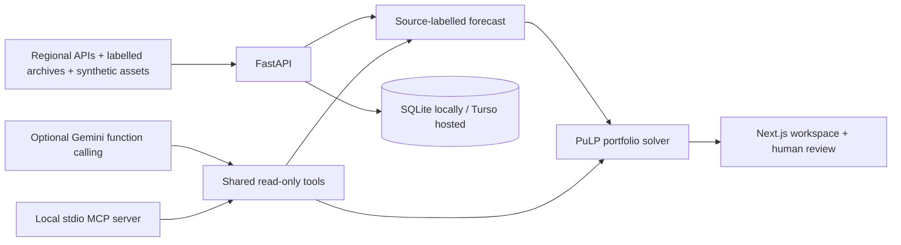

# Meridian Grid

Bangladesh-focused energy planning prototype for regional solar/carbon outlooks, flexible industrial processes and batteries.

Live app: https://meridian-grid-bd.vercel.app/

## What works

- Regional Open-Meteo weather forecasts with a labelled 2020 archive fallback.
- Electricity Maps carbon forecasts or recent readings when access is available, with labelled archived fallback.
- PuLP mixed-integer scheduling with process windows, battery constraints, optional PV/base load and a shared feeder limit.
- Custom machines included in the full portfolio preview, saved plans and manual schedule overrides.
- JWT sign-in, role checks, saved plan history and approve/reject decisions.
- English-only interface, a public product guide and an interactive workflow walkthrough.
- Source-labelled Copilot tools with optional Gemini reasoning and a separate local stdio MCP server.
- Admin-edited `/docs` publishing with visibility and timezone-aware scheduling. Default window: June 10–14, 2027, Asia/Dhaka.

## Demo limits

All facility assets and electricity tariffs are synthetic. Results are modeled comparisons, not measured facility savings. No physical equipment is connected. Negative savings indicate increases; negative scenario deltas indicate reductions.

GHI is regional irradiance in W/m², not a facility's measured PV generation. Display ranges are fixed −25% / +18% scenarios, not calibrated P10/P90 probabilities. The historical LightGBM artifact is disabled pending runtime validation. RAG and GraphRAG are not implemented.

Schedule hours are offsets from the returned first forecast timestamp. Archived forecasts retain their historical timestamps. Electricity Maps access and Open-Meteo availability are separate from application availability.

## Architecture



## Local setup

Use Python 3.11+ and Node.js 20.9+. From the repository root:

```powershell
Copy-Item .env.example .env
python -m venv .venv
.venv/Scripts/python.exe -m pip install -r requirements.txt
.venv/Scripts/python.exe -m uvicorn main:app --app-dir backend --reload --port 8000
```

On Linux/macOS, replace `.venv/Scripts/python.exe` with `.venv/bin/python`. Configure a unique `SECRET_KEY` of at least 32 characters. A fresh local database receives a generated first-login admin credential in the ignored `backend/.initial-admin-credential`; change the password immediately.

In a second terminal:

```sh
cd frontend
npm ci
npm run dev
```

Backend: http://localhost:8000. Frontend: http://localhost:3000. Backend `/docs` is Swagger; frontend `/docs` is the scheduled public showcase.

## Copilot and MCP

Guest Copilot requests use local demo tools and never call Gemini. Authenticated requests may use `GEMINI_API_KEY`, with `COPILOT_MODEL=gemini-2.5-flash` by default. `COPILOT_DAILY_MODEL_CALLS=100` caps upstream model HTTP calls per UTC day and API process; zero disables paid calls. No key or exhausted budget uses explicit local-tool fallback.

Chat history is limited to six text turns of 2,000 characters each. Chat requests are limited to 6/minute per guest IP and 20/minute per account, with two concurrent Copilot requests. Solver calls have a 15-second limit. These are single-process demo guards; counters reset on restart. Configure provider-side quotas as an additional deployment control.

Run the local MCP server from the repository root:

```sh
python backend/run_mcp.py
```

It exposes four read-only tools: `get_solar_forecast`, `get_dispatch_schedule`, `simulate_whatif`, and `explain_decision`. Their scope is the unsaved synthetic portfolio, not a user's private saved plan. Copy `.mcp.json.example` to your host's MCP configuration and use absolute Python/script paths if its working directory differs. Local `.mcp.json` is ignored by Git. `/copilot/tools` is an HTTP catalog, not an MCP transport. No public remote MCP listener is enabled.

## Verification

```powershell
.venv/Scripts/python.exe -m pytest -q
cd frontend
npm run test
npm run lint
npm run build
npm run test:project
```

Backend tests isolate credentials, mock upstream calls and use temporary SQLite databases. The MCP test initializes a real stdio client and calls a tool. The browser regression runs an isolated backend and production frontend, covering publishing controls, custom machine persistence, public pages and conversation history. Windows uses installed Edge; Linux CI installs Playwright Chromium. `PYTHON` can override the browser test's Python executable.

A GitHub Actions template is provided at `docs/architecture/github-actions-checks.yml.example`. It is inactive: the current GitHub push token cannot create workflows. Once a token with workflow permission is available, place the template at `.github/workflows/checks.yml` to run these checks on pushes and pull requests.

## Vercel + Render + Turso deployment

1. Create a Turso database and Read & Write token. Keep both token and API credentials out of Git.
2. Render Python web service, repository root, build `pip install -r requirements.txt`, start `cd backend && uvicorn main:app --host 0.0.0.0 --port $PORT`.
3. Configure `PYTHON_VERSION=3.11.11`, `TURSO_DATABASE_URL` (`libsql://...`), `TURSO_AUTH_TOKEN`, a unique `SECRET_KEY`, and `CORS_ORIGINS` with the exact Vercel HTTPS origin. On an empty database, set a unique `INITIAL_ADMIN_PASSWORD` of at least 20 characters; change it after first sign-in and remove the variable.
4. Optional backend variables: `ELECTRICITY_MAPS_API_KEY`, `GEMINI_API_KEY`, `COPILOT_MODEL`, `COPILOT_DAILY_MODEL_CALLS`. Frontend environment variables must not contain these keys.
5. Vercel root directory: `frontend`. Set `NEXT_PUBLIC_API_URL` and `API_INTERNAL_URL` to the Render HTTPS origin, without a trailing slash. Rebuild after changing frontend environment values.
6. Verify login, a full saved plan, restart/read-back and `/docs` OFF/ON. Local SQLite data is not uploaded automatically.

Render Free sleeps after inactivity, so its in-process carbon poller cannot run continuously. Cold starts can delay requests. The Turso SQLAlchemy driver supports Linux/macOS; hosted-driver validation must run on Render. SQLite configuration, auth, planner and MCP paths are tested locally. Production load testing and real facility validation remain outstanding.

## Public website

Home, `/about` and `/guide` explain the product without an account or backend dependency. The interactive walkthrough covers inputs, forecast context, optimization and review. The separate `/docs` showcase keeps its admin publishing controls and scheduled availability.

## API and documentation

| Endpoint | Purpose | Access |
| --- | --- | --- |
| `POST /auth/signup`, `POST /auth/login` | Accounts and tokens | Public, rate limited |
| `GET /forecast/bd` | Regional forecast and sources | JWT |
| `GET /dispatch/plan` | Unsaved portfolio preview | JWT |
| `POST /dispatch/custom-asset` | Preview custom portfolio | JWT |
| `POST /dispatch/runs` | Save a portfolio, including custom definitions | JWT |
| `POST /dispatch/override` | Re-solve and save a whole-hour shift | JWT |
| `POST /dispatch/scenarios` | Compare explicit PV capacity with zero PV | JWT |
| `POST /copilot/chat` | Bounded local tools / optional Gemini | Public demo / JWT |
| `GET /copilot/tools` | Tool catalog | Public |
| `GET /showcase/public` | Published showcase during its window | Public when enabled |
| `/showcase/admin/*` | Draft editing, publishing and schedule | Admin |

See [Copilot and MCP](docs/architecture/PHASE_5_COPILOT_AND_MCP_SPEC.md), [advanced feature scope](docs/architecture/PHASE_7_ADVANCED_FEATURES_SPEC.md), [system guide](docs/MASTER_SYSTEM_AUDIT_AND_DEV_GUIDE.md), and [operations](docs/product/SYSTEM_SHOWCASE_AND_OPERATIONS_GUIDE.md).

Project changes should follow [AGENTS.md](AGENTS.md). Submission media and private working documents remain local and ignored by Git.
