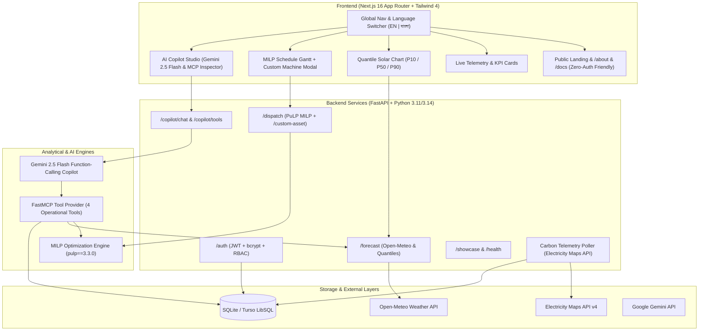

# 📖 Meridian Grid — Master System Audit & Developer Handover Guide
**CloudCampBD Congress 2026 &bull; Idea to Unicorn (I2U) &bull; ClimaTech / Energy Brain Challenge**

---

## 1. Executive Summary & Problem Context

In Bangladesh's industrial hubs—particularly Ready-Made Garments (RMG), textile mills, and cold storage facilities in Gazipur, Savar, and Narayanganj—industrial electricity tariffs follow sharp Time-of-Use (TOU) rates:
- **Off-Peak (23:00 - 07:00)**: ~4.50 BDT / kWh
- **Standard Day (07:00 - 17:00)**: ~9.80 BDT / kWh
- **Peak Hours (17:00 - 23:00)**: ~14.50 BDT / kWh (over $3\times$ off-peak)

Simultaneously, the national grid carbon intensity peaks in evening hours ($\sim 650\text{ gCO}_2\text{eq/kWh}$) when inefficient peaking gas and furnace-oil power plants are spun up to meet evening residential demand.

**Meridian Grid** is an end-to-end flexible-load orchestration and carbon-aware dispatch engine that:
1. Forecasts regional rooftop solar PV generation using satellite irradiance data (Open-Meteo GHI + historical NREL NSRDB).
2. Gathers real-time and fallback grid carbon intensity telemetry.
3. Formulates and solves a Mixed-Integer Linear Programming (MILP) dual-objective optimization problem using PuLP and HiGHS/CBC solvers.
4. Provides an enterprise-grade AI Copilot powered by Google Gemini 2.5 Flash and Model Context Protocol (MCP) to explain decisions and run what-if simulations in plain English and Bengali.
5. Seamlessly shifts flexible loads (dyeing autoclaves, spinning mills, electric boilers, compressors) and orchestrates Battery Energy Storage Systems (BESS) into clean solar and low-tariff windows.

---

## 2. Complete Phase Architecture & Evolution



### Phase-by-Phase Deliverables:
- **Phase 1-2: Core Backend & Data Foundation**
  - Database schema (`backend/db/models.py`) with users, solar forecasts, carbon snapshots, dispatch runs, and audit logs.
  - JWT authentication with secure password hashing (`backend/auth/`).
- **Phase 3: MILP Optimization Solver**
  - High-performance linear programming engine (`backend/dispatch/joint.py`).
  - Industrial asset model (`IndustrialProcessAdapter`) and battery storage model (`BatteryAssetAdapter`).
  - TOU cost minimization and carbon penalty dual-objective weighting.
- **Phase 4: Next.js 16 Dashboard & Visual Analytics**
  - Clean glassmorphism UI, interactive charts via Recharts, responsive layout.
  - Public `/about` showcase and `/docs` documentation renderer.
- **Phase 5: Grounded AI Copilot & Model Context Protocol (MCP)**
  - Standalone FastMCP tool definitions (`backend/agent/tools.py` & `backend/agent/mcp_server.py`).
  - Google Gemini 2.5 Flash multi-turn function-calling integration with local deterministic fallback (`backend/agent/copilot_service.py`).
  - Frontend Copilot Studio with role switching and payload inspector (`frontend/src/app/(dashboard)/copilot/page.tsx`).
- **Phase 6: Stage Resilience & Deployment Hardening**
  - Vercel + Render + Turso deployment configs.
  - Offline fallback resilience for zero-connectivity environments.
- **Phase 7: Advanced Feature Set**
  - **Feature 1**: Bilingual Localization (English & Bengali) across navigation, controls, and data cards.
  - **Feature 2**: Probabilistic Solar Forecasting with $P_{10}$ (overcast), $P_{50}$ (expected median), and $P_{90}$ (clearsky) quantiles.
  - **Feature 3**: Dynamic Custom Machine Ingestion (`POST /dispatch/custom-asset`) allowing on-the-fly factory machine onboarding and joint MILP re-optimization.

---

## 3. Directory Structure & Key Files

| Directory / File | Description | Critical Details |
|---|---|---|
| `backend/main.py` | FastAPI application root | Mounts all routers, CORS origins, health check, poller startup |
| `backend/config.py` | Environment configuration | Pydantic Settings reading `GEMINI_API_KEY`, `SECRET_KEY`, `DB_PATH`, `TURSO_*` |
| `backend/dispatch/joint.py` | PuLP MILP formulation | Defines binary and continuous decision variables, feeder limits, battery SoC balance |
| `backend/dispatch/api.py` | Dispatch API router | Exposes `/dispatch/runs`, `/dispatch/runs/latest`, `/dispatch/override`, `/dispatch/custom-asset` |
| `backend/agent/tools.py` | MCP operational tools | 4 Grounded tools: solar forecast, dispatch plan, what-if simulator, asset decision explainer |
| `backend/agent/copilot_service.py` | Gemini 2.5 Flash agent | Handles tool declaration, API execution, role grounding, and local fallback |
| `backend/agent/router.py` | Copilot REST endpoints | `POST /copilot/chat` and `GET /copilot/tools` (supports unauthenticated demo sessions) |
| `backend/forecasting/router.py` | Solar forecast router | Calculates $P_{10}, P_{50}, P_{90}$ irradiance bounds with Open-Meteo or synthetic baseline |
| `frontend/src/lib/i18n/translations.ts`| Bilingual dictionary | Complete English & Bengali UI labels for all app components |
| `frontend/src/lib/store/useLanguageStore.ts` | Language state store | Lightweight client store with localStorage persistence |
| `frontend/src/components/common/language-toggle.tsx` | UI Switcher | Pill button `[ 🌐 EN | বাংলা ]` |
| `frontend/src/app/(dashboard)/dispatch/page.tsx` | Dispatch Studio | Interactive schedule table, Gantt timeline, "+ Add Custom Machine" modal |
| `frontend/src/app/(dashboard)/copilot/page.tsx` | Copilot Studio | Real-time chat, tool call badges, role selector, scenario calculator |
| `frontend/src/app/(marketing)/docs/page.tsx` | Public Docs Hub | Renders markdown docs with offline `STATIC_DOCS_FALLBACK` guarantee |
| `frontend/src/app/about/page.tsx` | Public About Page | Zero-auth visual showcase: What, How, Where, Who, and Financial Impact |

---

## 4. Key Endpoints Reference

### AI Copilot & MCP
- `POST /copilot/chat`:
  - **Request Body**: `{"message": str, "role": "facility_manager" | "grid_operator", "context_window": list}`
  - **Behavior**: Calls Google Gemini 2.5 Flash with registered tools. If the model invokes tools, the server executes them and feeds observations back to Gemini. If offline or without API key, triggers deterministic local scenario engine.
- `GET /copilot/tools`:
  - Lists the 4 active MCP tools with schema and parameter metadata.

### Dynamic Machine Ingestion
- `POST /dispatch/custom-asset`:
  - **Request Body**:
    ```json
    {
      "asset_id": "custom-compressor-01",
      "name": "Heavy Screw Air Compressor",
      "power_kw": 85.0,
      "duration_hours": 3,
      "deadline_hour": 18,
      "earliest_hour": 6,
      "carbon_penalty_weight": 0.05
    }
    ```
  - **Response**: Optimal assigned start hour, total operational cost, carbon emissions, and baseline comparison.

### Quantile Solar Forecasting
- `GET /forecast/bd?horizon_hours=24`:
  - Returns hourly `expected_generation_kw` ($P_{50}$), `p10_generation_kw`, `p90_generation_kw`, and `ghi_w_per_m2`.

---

## 5. Verification & Testing Playbook

### Running All Backend Tests
```powershell
# Using Python 3.11+ virtual environment
& "D:\PythonProjects\.venv\Scripts\python.exe" -m pytest backend/dispatch/test_api.py backend/forecasting/test_forecasting.py backend/agent/test_agent.py backend/showcase/test_showcase.py -v
```
*Expected Result*: **11 passed**.

### Running Frontend Type Checks & Tests
```bash
# Type check without emitting files
node frontend/node_modules/typescript/bin/tsc --project frontend/tsconfig.json --noEmit

# Unit test suite
npm --prefix frontend run test -- --run
```
*Expected Result*: **0 errors, all unit tests passed**.

---

## 6. Known Quirks & Troubleshooting Guide

1. **PuLP Version Requirement**:
   - `pulp==3.3.0` **MUST** be used.
   - Do *NOT* upgrade to `pulp>=4.0.0` because PuLP 4 rewrote the solver interface in Rust and eliminated the `lowBound` keyword argument from `LpVariable`, breaking `backend/dispatch/joint.py`.
2. **Windows Terminal Character Encoding**:
   - When printing Bengali text from Python on Windows, powershell may throw `UnicodeEncodeError: 'charmap' codec can't encode characters`.
   - Always ensure scripts execute with UTF-8 encoding or set:
     ```python
     import sys
     sys.stdout.reconfigure(encoding='utf-8')
     ```
3. **Public Access vs Authenticated Protection**:
   - Critical operational endpoints require JWT tokens (`Depends(get_current_user)`).
   - Public showcase endpoints (`/about`, `/docs`, `/health`, `/showcase/*`) and demo copilot (`/copilot/chat` using `get_optional_current_user`) are accessible without authentication so evaluators and judges can test the system immediately without sign-up friction.
4. **Gemini API Key Fallback**:
   - If `GEMINI_API_KEY` is omitted or invalid, `copilot_service.py` gracefully degrades to deterministic local rule-based responses. The app will never crash with a 500 server error.
5. **Static Documentation Fallback**:
   - If the backend is suspended or cold during static site rendering, `frontend/src/app/(marketing)/docs/page.tsx` automatically renders `STATIC_DOCS_FALLBACK` markdown data, ensuring zero blank-screen failures.

